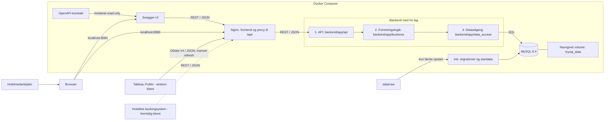

# Hotel Kong Arthur

Dette projekt skal gøre det lettere at holde styr på hotellets reservationer og følge udviklingen i hotellets og Helene Christines omsætning.

## Hvor langt er vi?

Bookinger og barsalg kan oprettes, findes, rettes og aflyses i browseren gennem API'et. Hotel- og baranalyser beregnes i backendens forretningslogik fra aktuelle MySQL-data. Tableau-dashboardet er bygget og bruger backendens OData-feed. [Milepæl 3-kontrollen](specs/004-hotelsystem/milestone-3.md) beskriver den afgrænsede kontrol af backendfunktionerne; den samlede afleveringsgennemgang mangler stadig.

**Tableau:** Dashboardet [`tableau/hotel-and-bar.twbx`](tableau/) virker. Det henter sine tal fra API'ets OData-feed, tallene stemmer med API'et for flere filtervalg, og manuel refresh er afprøvet efter oprettelse, rettelse og aflysning af både bookinger og barsalg, også når API'et er nede. Se [vejledningen](tableau/README.md).

**Åbne fortolkningsrisici:** Manglende kundetilfredshedsdata og Tableau uden for Docker er gruppens egne valg og er ikke afstemt med underviseren.

**Mangler endnu:** Gruppen har kørt en stikprøve på 12 refresh-runder i stedet for de 60 (T055), så SC-003 kun er delvist opfyldt; se [kontrolarket](tableau/sc003-kontrolark.md). Testpersonens prøve, gruppens review og præsentationen står åbne (T063, T067, T068), og enkelte Tableau-prøver mangler (T069–T071). Status for hvert krav står i [Converge](specs/004-hotelsystem/converge.md). Se [tasklisten](specs/004-hotelsystem/tasks.md) for status.

## Start systemet

Systemet kræver kun Docker. Kør dette fra projektmappen:

```sh
docker compose up
```

| Adresse | Indhold |
|---|---|
| <http://localhost:8080> | Bookingfrontend |
| <http://localhost:8080/sales.html> | Barsalg og historik |
| <http://localhost:8080/api/analytics/hotel> | Hotelanalyse for indeværende år |
| <http://localhost:8080/api/analytics/bar> | Baranalyse for Helene Christine, indeværende år |
| <http://localhost:8080/api/health> | API'ets driftsstatus |
| <http://localhost:8081> | Swagger UI med OpenAPI-kontrakten |

| Handling | Kommando | Data |
|---|---|---|
| Stop | `Ctrl+C` eller `docker compose stop` | Bevares |
| Stop og fjern containere | `docker compose down` | Bevares |
| **Nulstil alt** | `docker compose down -v` | **Slettes**, og startdata indlæses igen ved næste start |

Hvis et andet program bruger port 8080 eller 8081, kan adresserne ramme det program i stedet for hotelsystemet, også selv om alle containere starter uden fejl. Stop det andet program før en demo.

## Projektets dokumenter

Følg [Spec Kit-overblikket](specs/README.md) i opgavens rækkefølge:

**Constitution → Specify → Clarify → Plan → Tasks → Implement → Converge**

- [Constitution](.specify/memory/constitution.md): principper og faste krav.
- [Specify](specs/004-hotelsystem/spec.md): gældende funktioner, regler og acceptkriterier.
- [Clarify](specs/004-hotelsystem/clarify.md): afklaringer, begrundelser og åbne punkter.
- [Plan](specs/004-hotelsystem/plan.md): teknologier, lagdeling, datamodel, API-design, opstart og verifikation.
- [Tasks](specs/004-hotelsystem/tasks.md): opgaver grupperet efter brugerhistorier, med status og afhængigheder.
- [OpenAPI-kontrakt](specs/004-hotelsystem/contracts/openapi.yaml): API'ets kontrakt, som også vises i Swagger UI.
- [Tableau-afprøvning](tableau/README.md): fixture og vejledning til prøven af OData i Tableau Public.
- [Converge](specs/004-hotelsystem/converge.md): status og bevis for hvert krav.
- [CONTRIBUTE](CONTRIBUTE.md): bidrag, review, tests og verifikation.

De tidligere dokumentationsopgaver ligger direkte under `specs/` i mapperne 001, 002 og 003; de er beskrevet i [overblikket](specs/README.md).

## Opgavebeskrivelse

De to opgave-PDF'er ligger i [`opgavebeskrivelse/`](opgavebeskrivelse/): [Hotel Kong Arthur-opgaven](opgavebeskrivelse/E26%20Tv%C3%A6rfaglig%20Opgave%20Hotel%20Kong%20Arthur.pdf) og [de supplerende spørgsmål](opgavebeskrivelse/Till%C3%A6gssp%C3%B8rgsm%C3%A5l_swa.pdf).

## Sådan hænger systemet sammen

Stiplede linjer er endnu ikke implementeret.



| Tjeneste | Rolle |
|---|---|
| `db` | MySQL. Kan kun nås internt, og data ligger i `mysql_data`. |
| `init` | Engangsjob, der kører migrationer og indlæser startdata, når databasen er klar. |
| `backend` | FastAPI med de tre lag. Starter først, når `init` er færdig. |
| `frontend` | Nginx, der serverer browserfronten og sender `/api/` videre til backend. |
| `swagger` | Swagger UI, der viser den versionerede kontrakt. |

Tjenesterne finder hinanden ved navn på Docker-netværket, fx `db` og `backend`. Kun `frontend` og `swagger` kan nås udefra, og kun fra din egen maskine.

Plan beskriver, hvorfor netop Python/FastAPI, SQLAlchemy/PyMySQL, MySQL og en HTML/CSS/JavaScript-frontend med Nginx er valgt. Gruppen har Tableau Public; OData V4 undersøges til API-baserede udtræk, og manuel refresh inde i Tableau er accepteret.

## Eksempel: en ny booking

1. En medarbejder udfylder formularen. `frontend/js/app.js` laver en idempotensnøgle og sender JSON til `POST /api/bookings`.
2. Nginx sender forespørgslen videre til backend.
3. `backend/app/api/bookings.py` kontrollerer formatet og oversætter JSON til et domæneobjekt.
4. `backend/app/business/booking_service.py` kontrollerer felterne, åbner en transaktion og låser værelsestypen gennem dataadgangen.
5. Servicen kontrollerer gæsteantal og ledig kapacitet for hver nat. Afvises bookingen, rulles alt tilbage, og brugeren får en JSON-fejl med en forståelig besked.
6. `backend/app/data_access/repositories.py` gemmer bookingen og idempotensresultatet i MySQL i samme transaktion.
7. API'et svarer `201` med bookingen og en `Location`-header, og browseren viser den i listen.

Går svaret tabt, og medarbejderen gemmer igen, genbruges samme nøgle. Så bliver der ikke oprettet en dobbelt booking.

## Tal, systemet skal kunne vise

Resultaterne leveres gennem REST API'et. Tableau-dashboardet er bygget; dets funktioner og de gennemførte og manglende refresh-prøver er beskrevet i [Tableau-vejledningen](tableau/README.md).

**Hotellet:** gæsternes lande, omsætning fordelt på værelsestype, sæson og land, de værelsestyper og lande der giver størst omsætning, årets samlede omsætning samt belægning og ADR. Gæstetilfredshed har intet datagrundlag og vises som »Intet datagrundlag«.

**Helene Christine:** årets samlede salg, omsætning pr. drik og fordelingen mellem cocktails og kaffe, både efter antal og omsætning.

Specifikationen definerer et valgbart kalenderår, sæsoner, natbaseret bookingomsætning og særskilt passeret og forventet omsætning. Opgavens værelsespriser er estimater og må ikke fremstilles som faktiske bookingindtægter.

### Fra analyseforespørgsel til tal

`GET /api/analytics/hotel?year=2026&season=low` går gennem Nginx → `api/analytics.py` → `business/analytics_service.py` → repositories/Unit of Work → MySQL. API-laget kontrollerer inputformat og formaterer svar. Businesslaget fordeler nætterne og beregner alle officielle tal. Dataadgangen henter domæneobjekter uden at beregne nøgletal i SQL.

Hver analyse åbner en separat `REPEATABLE READ`-transaktion med et eksplicit konsistent snapshot og kun læsning. Kataloger og driftsdata læses fra samme snapshot. Skrivetransaktionerne bruger stadig `READ COMMITTED`. Der er ingen cache eller rapporttabeller; ændringer ses ved næste API-kald.

- Hotellet: `year` (2000–2100), valgfri `season`, `countryId` og `roomTypeId`. Nætter fordeles i `past`, `upcoming` og `all`; dags dato i Europe/Copenhagen tilhører `upcoming`.
- Baren: `year` og valgfri `employeeId`; standard er Helene Christine. Alle 30 katalogdrikke og begge kategorier medtages, også uden salg.
- Belægning = bookede værelsesnætter / tilgængelige værelsesnætter × 100. Landevalg ændrer tælleren, mens kapaciteten bevares. ADR = omsætning / bookede værelsesnætter. Ved nul nævner er forholdstallet `null` med `no_data`; summer er nul.
- En booking med to gæster og tre nætter til 1.000 DKK giver 2 gæsteophold, 3 værelsesnætter og 3.000 DKK. Med to værelser over to nætter giver én booking begge nætter 50 % belægning og ADR på 1.000 DKK.
- Aflyste bookinger og salg udelades helt. Aftalte priser bevares uafhængigt af katalogpriser. Ranglister følger `1, 1, 3` ved delt førsteplads. Beløb og procenter leveres som strenge med to decimaler.

`POST /api/bar-sales` bruger `Idempotency-Key` som bookingoprettelse. Salg og det oprindelige svar gemmes atomisk. Samme nøgle og input giver samme svar, også efter senere rettelse/aflysning. En anden payload med samme nøgle giver 409. `PUT` kan ikke rette en aflyst post; gentaget `DELETE` ændrer ikke aflysningstidspunktet.

## Data

De oprindelige datafiler ligger uændret i [`data/raw/`](data/raw/). Ved første start på en tom database sker dette i én transaktion:

- **Kataloger:** 21 lande (de 20 fra hoteldataene og Danmark), 8 værelsestyper med i alt 214 værelser og 30 drikke (20 cocktails og 10 kaffetyper).
- **Referenceposter:** 1.000 hotelposter og 30 drikke gemmes uændret og adskilt fra bookinger. De indgår ikke som aktuelle data, fordi de mangler datoer.
- **Demodata:** 24 bookinger og 12 barsalg, der er reproducerbare og mærket »Demodata«.
- **Importrapport:** Tabellen `import_reports` viser, hvad der er udeladt. Det gælder den løse værdi `5379` i celle E1002 og CSV-filen, som ikke importeres, fordi den indeholder de samme poster som Excel-filen og 54 erstatningstegn (`�`) i navne.

Ved senere starter genindlæses intet, og ændringer bevares. Indeholder databasen data uden en fuldført markør, stopper `init` med en fejl i stedet for at overskrive noget.

Antal værelser, gæstegrænser og vejledende priser pr. type er konstruerede demodata, ikke hotellets faktiske fordeling.

## Kendte begrænsninger

- **Ingen adgangskontrol:** Alle, der kan nå API'et, kan læse og ændre data. Det er et bevidst valg for prototypen og den største mangel før produktion.
- **Én backend og én database:** Ændringer på samme værelsestype venter på hinanden, og systemet har ingen høj tilgængelighed.

## Tests og bidrag

```sh
docker compose --profile test run --build --rm test
```

Kommandoen bruger sin egen database og rører ikke demoens data. Arbejdsgangen er beskrevet i [CONTRIBUTE.md](CONTRIBUTE.md). Alle i gruppen skal kunne forklare den kode og dokumentation, de afleverer, også når AI har været brugt som hjælp.

Spec Kit-værktøjet i `.specify/` stammer fra [GitHub Spec Kit](https://github.com/github/spec-kit). Licensen følger med i `.specify/LICENSE.spec-kit`.
