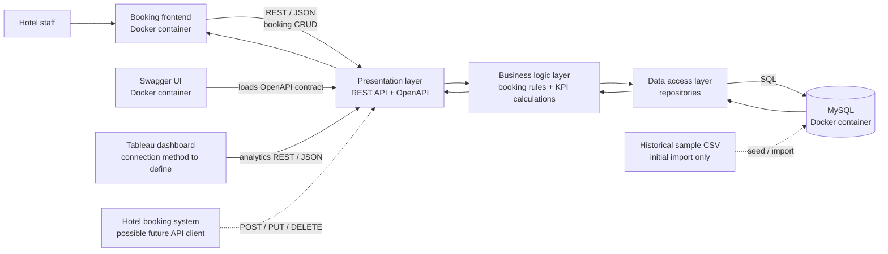

# Hotel Kong Arthur Analytics Platform

> **Project status:** Planning scaffold. The architecture below is the proposed target design; the application code, API endpoints, database schema, and Tableau connection have not yet been implemented or verified.

## Purpose

Build a prototype that supports current hotel bookings and operational analytics for Hotel Kong Arthur. The system must use a three-layer backend, a REST/JSON interface described by OpenAPI, MySQL, Docker Compose, a browser booking interface, and an interactive Tableau dashboard.

## Proposed architecture



### Component responsibilities

- **Booking frontend:** lets hotel staff create, edit, delete, and view bookings through the API.
- **Presentation layer:** exposes REST resources and JSON schemas, applies request-level validation, returns HTTP status codes, and publishes the OpenAPI contract.
- **Business logic layer:** applies booking and domain rules and calculates the official hotel and bar KPIs.
- **Data access layer:** persists and queries records in MySQL without owning business decisions.
- **MySQL:** stores operational bookings and the hotel/bar data required for current analytics.
- **Swagger UI:** displays the API contract and supports API exploration; it runs as a Docker service.
- **Tableau:** presents interactive analytics using current data obtained through the REST API. Its connector and refresh strategy remain to be selected in the plan.
- **CSV sample:** may provide an initial historical dataset, but current data must be writable through the API.

The diagram describes the required target architecture. Container names, ports, endpoint paths, and the Tableau connector are implementation decisions for the plan and OpenAPI contract.

## Booking request walkthrough

The following uses `POST /api/bookings` as a proposed example endpoint. The final path and JSON schema must be defined in OpenAPI before implementation.

1. A receptionist enters booking details in the browser frontend and submits the form.
2. The frontend sends a JSON `POST /api/bookings` request to the API.
3. The presentation layer checks the request against the API schema and turns it into an application command. It does not decide domain policy.
4. The business logic layer checks the booking rules, such as valid dates, guest capacity, and room availability. The group must define these rules in the specification.
5. The data-access layer writes the booking to MySQL, using a transaction where a booking operation spans multiple records.
6. The API returns a response such as `201 Created` with the saved booking representation and resource location.
7. The frontend shows the result and refreshes the relevant booking or occupancy view from the API.

Edits and deletions follow the same layer boundaries, using the HTTP method and status codes specified in OpenAPI. Tableau reads analytics through API endpoints; it does not access MySQL directly.

## Required analytics

### Hotel

- Guest origin by country.
- Revenue overall, by room type and season, and by country.
- Highest-revenue room types and countries.
- Annual hotel revenue.
- One additional KPI selected and defined by the group.
- Occupancy and customer satisfaction KPIs where the available operational and feedback data supports a clear definition.

### Cocktail bar

- Helene Christine's total sales for the year.
- Revenue per drink.
- Percentage split of cocktails and coffee.

The backend business-logic layer is the proposed source for official KPI definitions and calculations; Tableau displays and filters those results. Before implementation, record the season definition, occupancy formula, reporting year, satisfaction source and scoring, revenue rules, source fields, and bar transaction data in the specification or plan. The room rates in the assignment are estimates, not verified booking revenue.

## Running the system

The acceptance target is a single command from the project root:

```sh
docker compose up
```

The Compose file and services have not been implemented yet. The plan must define startup readiness for MySQL, persistent storage for database data, service networking, and how Swagger UI receives the API's OpenAPI document.

## Spec-driven workflow

Project artifacts belong in the repository and should follow the assignment's workflow:

1. Constitution
2. Specify
3. Clarify
4. Plan
5. Tasks
6. Implement
7. Converge

The initial constitution is a draft pending group review. Feature specifications must include user stories and acceptance criteria. Converge should state what is implemented and what remains incomplete or unresolved.

The Spec Kit scaffold under `.specify/` is sourced from [GitHub Spec Kit](https://github.com/github/spec-kit). Its MIT license notice is included in `.specify/LICENSE.spec-kit`.

## Contribution and documentation

The assignment evaluates participation through Git commits. Commit small, meaningful work as it is completed, with each group member using their own Git identity for their contribution. AI-assisted changes must be reviewed and understood by the group.

The software architecture hand-in also requires `CONTRIBUTE.md`, the OpenAPI specification, and this README with the system architecture diagram. They are not present yet and should be added as implementation proceeds.

## Open decisions

- Exact booking fields and endpoints, based on the sample data and required frontend.
- Season boundaries, occupancy denominator, reporting year, and revenue inclusions.
- Storage model and source data for room rates and bar transactions.
- The additional hotel KPI and its business definition.
- Tableau REST/JSON connector and data refresh behavior.
- Docker service layout, ports, database readiness, and volume policy.
