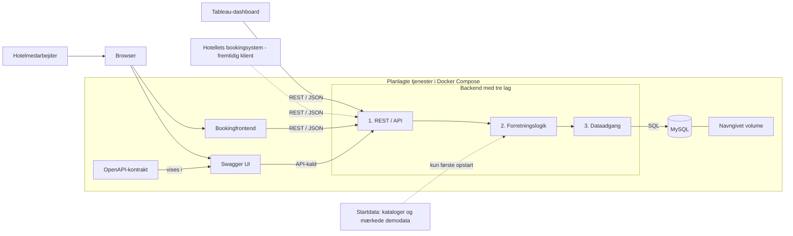

# Hotel Kong Arthur

Dette projekt skal gøre det lettere at holde styr på hotellets reservationer og følge udviklingen i hotellets og Helene Christines omsætning.

## Hvor langt er vi?

Projektet er stadig på planlægningsstadiet. Der er endnu ikke skrevet en kørende applikation, API, database eller Tableau-forbindelse. Diagrammet og gennemgangen nedenfor viser den arkitektur, vi skal arbejde hen imod.

## Projektets dokumenter

Følg [Spec Kit-overblikket](specs/README.md) i opgavens rækkefølge:

**Constitution → Specify → Clarify → Plan → Tasks → Implement → Converge**

- [Constitution](.specify/memory/constitution.md): principper og faste krav.
- [Specify](specs/004-hotelsystem/spec.md): gældende funktioner, regler og acceptkriterier.
- [Clarify](specs/004-hotelsystem/clarify.md): afklaringer, begrundelser og åbne punkter.
- [Plan](specs/004-hotelsystem/plan.md): teknologier, lagdeling, datamodel, API-design, opstart og verifikation.
- [CONTRIBUTE](CONTRIBUTE.md): bidrag, review og verifikation.

Plan er udarbejdet til gennemgang; Tableau-afprøvningen er fortsat åben. De tidligere dokumentationsopgaver ligger igen direkte under `specs/` i mapperne 001, 002 og 003; de er beskrevet i [overblikket](specs/README.md).

## Opgavebeskrivelse

De to opgave-PDF'er ligger i [`opgavebeskrivelse/`](opgavebeskrivelse/): [Hotel Kong Arthur-opgaven](opgavebeskrivelse/E26%20Tv%C3%A6rfaglig%20Opgave%20Hotel%20Kong%20Arthur.pdf) og [de supplerende spørgsmål](opgavebeskrivelse/Till%C3%A6gssp%C3%B8rgsm%C3%A5l_swa.pdf).

## Sådan hænger systemet sammen



Bookingløsningen bruger API'et til at oprette, rette, vise og slette bookinger. API'et modtager og sender JSON. Forretningslogikken håndterer regler og beregninger, mens dataadgangen læser og skriver i MySQL. Tableau skal hente aktuelle tal gennem API'et; CSV-filer kan bruges som startdata, men ikke som eneste måde at opdatere systemet på.

Plan vælger Python/FastAPI, SQLAlchemy/PyMySQL, MySQL 8.4 og en HTML/CSS/JavaScript-frontend med Nginx. Swagger UI viser den versionerede OpenAPI-kontrakt i Docker. De konkrete tjenester er beskrevet i Plan. Gruppen har Tableau Public; OData V4 undersøges til API-baserede udtræk. Brugeren har accepteret manuel datakilde-refresh inde i Tableau; det tidligere femsekunderskrav er erstattet. Den konkrete refresh-forbindelse er endnu ikke afprøvet.

## Eksempel: en ny booking

1. En medarbejder udfylder bookingformularen i browseren.
2. Browseren sender oplysningerne som JSON til API'et.
3. API-laget kontrollerer formatet og sender anmodningen videre.
4. Forretningslogikken kontrollerer bookingreglerne, for eksempel datoer, kapacitet og ledige værelser.
5. Dataadgangen gemmer bookingen i MySQL.
6. API'et svarer med resultatet, og browseren viser den gemte booking.

De endelige adresser, felter, svar og statuskoder skal beskrives i OpenAPI-kontrakten. Tableau skal læse analysetal fra API'et og må ikke hente dem direkte fra databasen.

## Tal, systemet skal kunne vise

**Hotellet:** gæsternes lande, omsætning fordelt på værelsestype, sæson og land, de værelsestyper og lande der giver størst omsætning, årets samlede omsætning samt mindst ét ekstra nøgletal. Belægning og gæstetilfredshed indgår, hvis datagrundlaget gør det muligt at beregne dem på en meningsfuld måde.

**Helene Christine:** årets samlede salg, omsætning pr. drik og fordelingen mellem cocktails og kaffe.

Specify er færdig i [`specs/004-hotelsystem/spec.md`](specs/004-hotelsystem/spec.md) med tilhørende afklaringer i [`clarify.md`](specs/004-hotelsystem/clarify.md). Den tekniske [Plan](specs/004-hotelsystem/plan.md) er udarbejdet med åbne fortolkningsrisici om kundetilfredshed og Tableau uden for Docker. Specifikationen definerer et valgbart kalenderår, sæsoner, natbaseret bookingomsætning, særskilt passeret og forventet omsætning, belægning og ADR. Barens fordeling vises både efter antal og omsætning. Opgavens værelsespriser er estimater og må ikke fremstilles som faktiske bookingindtægter. Gæstetilfredshed har endnu intet datagrundlag.

## Medfølgende eksempeldata

De oprindelige datafiler ligger i [`data/raw/`](data/raw/). Hoteldataene findes både som CSV og Excel med 1.000 gæsteposter. Barens Excel-fil indeholder 20 cocktails og 10 kaffetyper med priser og solgte enheder. Filerne er reference- og eksempeldata; de er ikke en database eller en mekanisme til at opdatere aktuelle data.

Filerne er bevaret uændret. Hotel-CSV'en indeholder 54 erstatningstegn (`�`) i navne, og Excel-udgaven har en ekstra værdi (`5379`) i celle E1002 ud over de 1.000 poster. Kontrollér og afklar disse værdier, før dataene indlæses eller bruges til analyser.

## Start af systemet

Målet er, at hele systemet kan startes fra projektmappen med:

```sh
docker compose up
```

Docker Compose-filen og tjenesterne er endnu ikke lavet. Plan beskriver database-healthcheck, migration/seed før backendstart, navngivet volume og Swagger UI med monteret kontrakt.

## Arbejdsgang og bidrag

Vi følger Spec Kit-forløbet: grundprincipper, specifikation, afklaringer, plan, opgaver, implementering og til sidst en gennemgang af, hvad der virker, og hvad der mangler. Hver brugerhistorie skal have acceptkriterier, som kontrolleres i den afsluttende gennemgang.

Gruppen skal gennemgå og godkende de foreløbige grundprincipper i `.specify/memory/constitution.md`. Alle i gruppen skal kunne forklare den kode og dokumentation, de afleverer, også når AI har været brugt som hjælp.

Arbejdsgangen er beskrevet i [CONTRIBUTE.md](CONTRIBUTE.md). OpenAPI-kontrakten mangler endnu og skal udarbejdes som designleverance efter Plan, før endpoints implementeres.

## Næste trin

Specify beskriver bookingfelter, salgsregler, analyser og acceptkriterier. Supplerende valg truffet ved færdiggørelsen er markeret i specifikationen. [Kvalitetskontrollen](specs/004-hotelsystem/checklists/requirements.md) beskriver dokumentationsstatus; funktionerne er endnu ikke implementeret.

Clarify har kontrolleret valgene samlet og dokumenteret afklaringerne i [clarify.md](specs/004-hotelsystem/clarify.md). [Plan](specs/004-hotelsystem/plan.md) fastlægger nu teknologier, datamodel, API-design, præcis demokapacitet, importmapping, Docker-opstart og teststrategi. Den fulde OpenAPI-kontrakt skal stadig udarbejdes og godkendes før endpointkode. Tableau-forbindelsen skal afprøves med manuel datakilde-refresh, som brugeren har accepteret. Efter refresh skal visningerne svare til API’ets aktuelle data og vise snapshot-tidspunktet. Clarify peger desuden på behov for afstemning med underviseren om manglende tilfredshedsberegning og fortolkningen af Tableau som ekstern klient uden for Docker. Disse punkter er endnu ikke dokumenteret accepteret.

Hoteldataene mangler opholdsdatoer og gæsteantal, mens barfilen mangler salgsdato og medarbejder. Udaterede referenceposter må derfor ikke præsenteres som faktiske kalenderårsdata. Specifikationen kræver særskilt mærkede demodata til de daterede demonstrationsforløb.

Spec Kit-værktøjet i `.specify/` stammer fra [GitHub Spec Kit](https://github.com/github/spec-kit). Licensen følger med i `.specify/LICENSE.spec-kit`.
