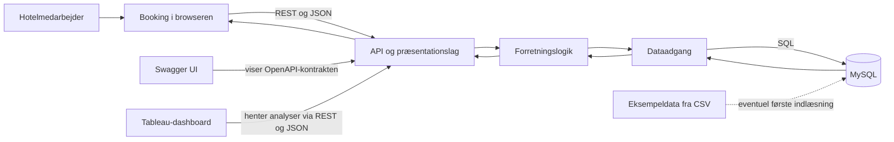

# Hotel Kong Arthur

Dette projekt skal gøre det lettere at holde styr på hotellets reservationer og følge udviklingen i hotellets og Helene Christines omsætning.

## Hvor langt er vi?

Projektet er stadig på planlægningsstadiet. Der er endnu ikke skrevet en kørende applikation, API, database eller Tableau-forbindelse. Diagrammet og gennemgangen nedenfor viser den arkitektur, vi skal arbejde hen imod.

## Opgavebeskrivelse

De to opgave-PDF'er ligger i [`opgavebeskrivelse/`](opgavebeskrivelse/): [Hotel Kong Arthur-opgaven](opgavebeskrivelse/E26%20Tv%C3%A6rfaglig%20Opgave%20Hotel%20Kong%20Arthur.pdf) og [de supplerende spørgsmål](opgavebeskrivelse/Till%C3%A6gssp%C3%B8rgsm%C3%A5l_swa.pdf).

## Sådan hænger systemet sammen



Bookingløsningen bruger API'et til at oprette, rette, vise og slette bookinger. API'et modtager og sender JSON. Forretningslogikken håndterer regler og beregninger, mens dataadgangen læser og skriver i MySQL. Tableau skal hente aktuelle tal gennem API'et; CSV-filer kan bruges som startdata, men ikke som eneste måde at opdatere systemet på.

Swagger UI skal gøre API-kontrakten tilgængelig i Docker. Tableau-forbindelsen og den endelige opbygning af Docker-tjenesterne er endnu ikke besluttet.

## Eksempel: en ny booking

1. En medarbejder udfylder bookingformularen i browseren.
2. Browseren sender oplysningerne som JSON til API'et.
3. API-laget kontrollerer formatet og sender anmodningen videre.
4. Forretningslogikken kontrollerer bookingreglerne, for eksempel datoer, kapacitet og ledige værelser.
5. Dataadgangen gemmer bookingen i MySQL.
6. API'et svarer med resultatet, og browseren viser den gemte booking.

De endelige adresser, felter, svar og statuskoder skal beskrives i OpenAPI-kontrakten. Tableau skal læse analysetal fra API'et og må ikke hente dem direkte fra databasen.

## Tal, systemet skal kunne vise

**Hotellet:** gæsternes lande, omsætning fordelt på værelsestype, sæson og land, de værelsestyper og lande der giver størst omsætning, årets samlede omsætning samt mindst ét ekstra nøgletal. Belægning og gæstetilfredshed indgår, hvis datagrundlaget gør det muligt at beregne dem på en meningsfuld måde.

**Helene Christine:** årets samlede salg, omsætning pr. drik og fordelingen mellem cocktails og kaffe.

Før tallene kan beregnes, skal gruppen beslutte blandt andet sæsonernes datoer, belægningsformlen, rapporteringsåret og hvilke indtægter der tæller med. Opgavens værelsespriser er estimater og må ikke fremstilles som faktiske bookingindtægter.

## Medfølgende eksempeldata

De oprindelige datafiler ligger i [`data/raw/`](data/raw/). Hoteldataene findes både som CSV og Excel med 1.000 gæsteposter. Barens Excel-fil indeholder 20 cocktails og 10 kaffetyper med priser og solgte enheder. Filerne er reference- og eksempeldata; de er ikke en database eller en mekanisme til at opdatere aktuelle data.

Filerne er bevaret uændret. Hotel-CSV'en indeholder 54 erstatningstegn (`�`) i navne, og Excel-udgaven har en ekstra værdi (`5379`) i celle E1002 ud over de 1.000 poster. Kontrollér og afklar disse værdier, før dataene indlæses eller bruges til analyser.

## Start af systemet

Målet er, at hele systemet kan startes fra projektmappen med:

```sh
docker compose up
```

Docker Compose-filen og tjenesterne er endnu ikke lavet. Planen skal også beskrive, hvordan databasen bliver klar, hvordan data bevares, og hvordan Swagger UI finder OpenAPI-kontrakten.

## Arbejdsgang og bidrag

Vi følger Spec Kit-forløbet: grundprincipper, specifikation, afklaringer, plan, opgaver, implementering og til sidst en gennemgang af, hvad der virker, og hvad der mangler. Hver brugerhistorie skal have acceptkriterier, som kontrolleres i den afsluttende gennemgang.

Gruppen skal gennemgå og godkende de foreløbige grundprincipper i `.specify/memory/constitution.md`. Alle i gruppen skal kunne forklare den kode og dokumentation, de afleverer, også når AI har været brugt som hjælp.

Afleveringen skal også indeholde `CONTRIBUTE.md` og OpenAPI-kontrakten. De mangler endnu og skal tilføjes, efterhånden som løsningen bliver bygget.

## Beslutninger, der mangler

- Hvilke felter en booking har, og hvilke API-adresser brugerfladen skal kalde.
- Hvordan sæsoner, belægning, rapporteringsår og omsætning defineres.
- Hvor værelsespriser og barens salgsdata kommer fra.
- Hvilket ekstra nøgletal hotellet skal have.
- Hvordan Tableau henter og opdaterer tal fra API'et.
- Hvilke Docker-tjenester der skal bruges, og hvordan databasen startes og gemmer data.

Spec Kit-værktøjet i `.specify/` stammer fra [GitHub Spec Kit](https://github.com/github/spec-kit). Licensen følger med i `.specify/LICENSE.spec-kit`.
