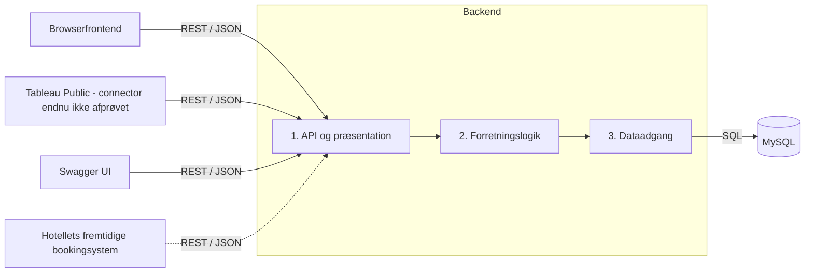

# Plan: Hotelsystem

**Dato:** 29. oktober 2026

**Branch:** `Plan`

**Status:** Teknisk plan udarbejdet til gruppens gennemgang. Tableau Public er bekræftet af gruppen. En praktisk integrationsprøve, den konkrete manuelle refresh i Public og de to fortolkningsrisici fra Clarify er åbne. Brugeren har accepteret manuel datakilde-refresh. Planen er ikke bevis for implementeret forbindelse eller gennemført acceptprøve.

**Grundlag:** [Specify](spec.md), [Clarify](clarify.md), [constitution](../../.specify/memory/constitution.md), begge opgave-PDF’er i `opgavebeskrivelse/`, Spec Kits planskabelon og [hotel-architecture-review](../../project-skills/hotel-architecture-review/SKILL.md).

Valgene nedenfor er forslag udarbejdet på brugerens anmodning, ikke nye interviewsvar. Spec beskriver fortsat hvad; denne plan beskriver hvordan. Domæneregler og formler gentages ikke som en konkurrerende kravbeskrivelse.

## 1. Hvilken teknisk løsning vælger vi?

Vi vælger en enkel webapplikation med én backendproces, en browserfrontend og MySQL. Der indføres ikke mikroservices eller en separat analysedatabase.

| Del | Valg | Begrundelse |
|---|---|---|
| Backend | Python 3.13, FastAPI og Uvicorn | Et lille REST/JSON API med tydelige moduler; egnet til datobehandling og Decimal-beregninger. |
| Request-/responsemodeller | Pydantic 2 | Kontrollerer JSON-struktur og typer. Domænevalidering udføres i logiklaget. |
| Dataadgang | SQLAlchemy 2 og PyMySQL | Transaktioner og parameteriseret dataadgang gennem en MySQL-driver. SQLAlchemy-objekter forlader ikke dataadgangen. |
| Databaseskema | Alembic-migrationer | Versionsstyrede skemaændringer frem for manuel oprettelse. |
| Database | MySQL 8.4, InnoDB, utf8mb4 | Opgavens databasekrav, transaktioner, fremmednøgler og internationale navne. |
| Frontend | HTML, CSS og JavaScript med Fetch API | Formularer og oversigter er afgrænsede; kræver ikke et frontendframework eller lokal Node-installation. |
| Webserver | Nginx | Serverer frontend og videresender `/api/` til backend, så browseren bruger samme origin. |
| Kontrakt og dokumentation | OpenAPI 3.0.3 og separat Swagger UI-container | Kontrakten er et versioneret artefakt før kode; Swagger UI viser netop denne fil. |
| Tests | pytest, HTTPX, OpenAPI-validering og Playwright | Regler, HTTP-forløb, rigtig MySQL og de centrale browserforløb. |
| Drift | Docker Compose v2 med navngivet MySQL-volume | Én opstartskommando og vedvarende data. |
| Analyseklient | Tableau Public, bekræftet af gruppen; OData V4 undersøges som API-forbindelse | OData-JSON kan levere data fra samme backendlogik. Connectoren bruger udtræk; manuel datakilde-refresh skal afprøves i Public. |

Versionsfamilierne er planvalg. Før implementering låses præcise kompatible pakkeversioner og container-digests i versionsstyrede filer og kontrolleres i containerbuild. Ingen afhængigheder installeres eller images hentes som del af denne dokumentationsændring.

## 2. Hvordan sikrer vi de tre lag?



| Lag | Ansvar | Konkrete planlagte filer |
|---|---|---|
| API | HTTP-routing, JSON-konvertering og oversættelse af domænefejl til statuskoder | `backend/app/api/bookings.py`, `sales.py`, `analytics.py`, `errors.py` |
| Forretningslogik | Bookingregler, natlig kapacitetskontrol, aflysning, filtrering, omsætning, belægning og ADR | `backend/app/business/booking_service.py`, `sale_service.py`, `analytics_service.py`, `models.py` |
| Dataadgang | MySQL-forbindelse, transaktioner, låsning, opslag og lagring | `backend/app/data_access/repositories.py`, `unit_of_work.py`, `orm_models.py` |

API’et importerer kun logiklagets indgange og transportmodeller. Logiklaget bruger dataadgangens grænseflade, som returnerer almindelige domæneobjekter. Kun dataadgangen kender SQLAlchemy og MySQL. `main.py` samler afhængigheder ved opstart; det er konfiguration, ikke en alternativ vej til databasen. En lille automatisk kontrol skal afvise SQLAlchemy-imports og SQL i API og logik.

Ved databaseskift udskiftes dataadgang, migrationer og driftskonfiguration. Ved frontendskift bevares backend og kontrakt. Transaktioner og specifik MySQL-låsning er derfor skjult bag dataadgangens metoder. Prisen for enkelheden er, at én backend og én database er fælles kapacitetsgrænser; prototypen har ikke krav om høj tilgængelighed.

### Eksempel: hvad sker der ved en booking?

1. Browseren sender `POST /api/bookings` med JSON og en `Idempotency-Key`.
2. API’et kontrollerer format og oversætter til et domæneinput. JSON-fejl giver et ensartet 400-svar; FastAPIs standardvalideringsfejl oversættes hertil.
3. Bookingservicen åbner en transaktion gennem dataadgangen og beder den låse den relevante værelsestype.
4. Dataadgangen henter typen og overlappende aktive bookinger. Servicen kontrollerer datoer, gæsteantal, pris og ledig kapacitet for hver nat.
5. Dataadgangen gemmer booking og idempotensresultat i samme transaktion. Commit sker før et successvar.
6. API’et returnerer 201, bookingens identitet og en `Location`-header. Browseren viser bookingen, og et analyseopslag kan nu se de committede data.

Et fejlforløb rulles tilbage. API’et eller browseren kan ikke tillade en booking, som logiklaget afviser.

## 3. Hvordan skal datamodellen se ud?

Alle primærnøgler er heltals-id’er. Fremmednøgler forbinder stamdata og driftsdata. Navne på tabeller og felter er engelske. Beløb lagres som `DECIMAL(12,2)` og behandles som Python `Decimal`. Kalenderdatoer er `DATE`; tekniske tidsstempler lagres i UTC. Hotellets dags dato udledes i Europe/Copenhagen.

| Tabel | Centrale felter og relationer |
|---|---|
| `countries` | `id`, unik `code`, `name`. De 20 lande fra hoteldata får en eksplicit mapping til ISO-landekoder. |
| `room_types` | `id`, unik `code`, `name`, `room_count`, `max_guests`, `demo_data`. Ingen fysisk værelsestildeling. |
| `room_type_prices` | `room_type_id`, `season`, `suggested_nightly_rate`; unik kombination af type og sæson. Vejledende demopriser. |
| `bookings` | `id`, `guest_name`, `country_id`, `room_type_id`, `arrival`, `departure`, `guest_count`, `nightly_rate`, `status`, `demo_data`, `created_at`, `updated_at`, `cancelled_at`. |
| `drinks` | `id`, `name`, `category`, `suggested_unit_price`; kategori `cocktail` eller `coffee`. |
| `employees` | `id`, unik `code`, `name`; Helene Christine og en tydeligt mærket demomedarbejder til filtertest. |
| `bar_sales` | `id`, `drink_id`, `employee_id`, `quantity`, `unit_price`, `sale_date`, `status`, `demo_data`, tekniske tidsstempler som booking. |
| `idempotency_requests` | Unik nøgle pr. HTTP-metode, sti og nøgle; payload-hash, svarkode og JSON-resultat. Skrives atomisk med ressourcen. |
| `seed_runs` | Unik seed-version, kildechecksums, datoforankring og afslutning. Forebygger gentagen indlæsning. |
| `import_reports` | Kilde, antal katalogposter, referenceposter og udeladte poster samt begrundelser. |
| `historical_reference_records` | Kilde, rækkenummer og originale værdier i JSON. Unik kilde/række; ingen relation der gør dem til aktive bookinger eller salg. |

Status er `active` eller `cancelled`. Databaseconstraints beskytter fremmednøgler, positive beløb/antal og tilladte statusværdier; logiklaget giver de forståelige fejl og håndhæver alle regler. Indekser lægges på bookingens type/status/datoer og barsalgets medarbejder/status/salgsdato. Navnesøgning har case-insensitiv sammenligning; `%` og `_` fra brugeren behandles bogstaveligt. Listsvar sorteres stabilt efter id og pagineres.

## 4. Hvordan undgår vi overbooking og dobbeltregistrering?

Vi serialiserer bookingændringer pr. værelsestype med `SELECT ... FOR UPDATE` på typen. Det beskytter også, når typen endnu ikke har nogen bookinger. Alle bookingoprettelser, rettelser og aflysninger følger samme låseprotokol.

Transaktionen bruger `READ COMMITTED`. Ved redigering/aflysning låses bookingrækken først. Gamle og nye typer låses derefter i stigende id-rækkefølge. Oprettelse låser kun typen; overlapopslag er almindelige læsninger og må ikke låse andre bookingrækker. Efter typelåsen læses det senest committede datagrundlag, og logiklaget tæller hver nat med egen booking udeladt. SQL tæller ikke kapacitet efter en alternativ domæneregel.

Ved typeskift kontrolleres og ændres hele bookingen atomisk. Låsekonflikter/deadlocks håndteres med højst tre transaktionsforsøg; fejler de, returneres 503 med `Retry-After`, ikke en falsk succes. En kapacitetskonflikt giver 409. Prisen er, at samtidige bookinger af samme type venter på hinanden; det er et bevidst valg til prototypens størrelse.

Frontend genererer én idempotensnøgle pr. oprettelse og genbruger den ved gentagelse efter netværksfejl. Identisk nøgle og input returnerer det oprindelige resultat; samme nøgle med andet input giver 409. En unik databaseconstraint og genlæsning efter rollback håndterer samtidige gentagelser. Nøgler bevares i prototypen. PUT erstatter alle redigerbare felter; identisk gentagelse giver samme tilstand. DELETE ændrer kun status én gang og ændrer ikke `cancelled_at` ved gentagelse.

## 5. Hvordan udformes REST API og OpenAPI?

Kontrakten skrives i `specs/004-hotelsystem/contracts/openapi.yaml` som første konkrete designleverance før endpoints. Endpointoversigten nedenfor er det valgte design, men erstatter ikke en fuld OpenAPI-fil med schemas, eksempler og svardefinitioner. Swagger UI skal montere den versionerede fil read-only; FastAPIs automatisk genererede schema må ikke blive en konkurrerende kontrakt.

| Metode og sti | Indhold og svar |
|---|---|
| `GET /api/bookings` | Navnedel `name`, datopar `arrivalFrom`/`departureTo` (overlappende nætter), `status=active|cancelled|all`, `offset` og `limit`. Returnerer `items` og `total`. |
| `POST /api/bookings` | Fuldt bookinginput og `Idempotency-Key`; 201 og `Location`. |
| `GET /api/bookings/{id}` | Aktiv booking; aflyst giver 404, medmindre `includeCancelled=true`. |
| `PUT /api/bookings/{id}` | Alle redigerbare felter; 200 og opdateret booking. |
| `DELETE /api/bookings/{id}` | Logisk aflysning; 204 også ved gentagelse. Ukendt id giver 404. |
| `GET/POST /api/bar-sales` | Salgsoversigt og oprettelse; samme pagination/status og idempotensmønster. Filtre: datoer og `employeeId`. |
| `GET/PUT/DELETE /api/bar-sales/{id}` | Samme enkeltopslag-, redigerings- og aflysningsregler som booking. |
| `GET /api/catalogs` | Lande, typer, sæsonpriser, medarbejdere og drikke gennem alle tre lag. |
| `GET /api/analytics/hotel` | `year`, valgfri `season`, `countryId`, `roomTypeId`; ét sammenhængende resultat med summer, opdelinger, lande, ranglister, belægning og ADR. |
| `GET /api/analytics/bar` | `year`, `employeeId`; standard Helene Christine. Summer, navngivne drikke og begge kategoriandele. |
| `GET /api/health` | 200 ved klar database og fuldført initialisering, ellers 503. Kontrollen går også gennem logik og dataadgang. |

Bookinginput bruger `guestName`, `countryId`, `arrival`, `departure`, `guestCount`, `roomTypeId`, `nightlyRate`. Salgsinput bruger `drinkId`, `employeeId`, `quantity`, `unitPrice`, `saleDate`. Pris- og beløbsfelter sendes som decimaltal i strenge, fx `"1000.00"`, så binære flydende tal ikke ændrer pengene. Connectoren skal afprøves med denne repræsentation.

Datoformat er `YYYY-MM-DD`. 400 dækker ugyldige felter og filtre, 404 ukendt/ikke synlig ressource, 409 kapacitetskonflikt eller forsøg på at ændre en aflyst post og 503 midlertidigt utilgængelig database. JSON-fejl har `code`, `message`, `fieldErrors` og `requestId`. Logs har request-id og teknisk fejlkontekst; fejlresponse indeholder ikke SQL eller stacktrace.

Transportmodeller må ikke indeholde flere forretningsregler end kontraktens strukturelle formater. Kontrakttests skal kontrollere svar, headers og de dokumenterede fejl, ikke kun om frameworkets genererede dokument ser gyldigt ud.

## 6. Hvordan leveres analyser uden forskellige beregningsregler?

Analysemodulet læser relevante aktive poster gennem dataadgangen og foretager datoopdeling og alle officielle beregninger i logiklaget efter spec. For 1.000 bookinger og 1.000 barsalg vælges gennemskuelig beregning i hukommelsen; ingen materialiserede rapporttabeller eller cache i første version.

Et hotelrespons indeholder `filters`, `generatedAt`, `businessDate`, `demoData`, `totals`, `byRoomTypeAndSeason`, `byCountry`, `guestStaysByCountry`, `topRoomTypes` og `topCountries`. `totals` har `past`, `upcoming` og `all`, hver med omsætning, bookede/tilgængelige værelsesnætter, belægning og ADR. Summer er tal/beløbsstrenge, udefinerede forholdstal er `null` med en visningsstatus. Tilfredshed leveres med status `no_data` og ingen score.

Barrespons indeholder samme metadata, årets omsætning og antal, `byDrink` og kategoriresultater med antal- og omsætningsandele. API’et returnerer et konsistent læsesnapshot pr. analyseforespørgsel; samme øjebliks datagrundlag anvendes til tællere, nævnere og opdelinger. Læsetransaktionens snapshot bruges kun til analyser og blandes ikke med bookingernes skrivelåse.

Tableau må formatere og visualisere resultatet og anvende filtre. Filtrering, der ændrer nævner, rangliste eller gæsteoptælling, skal bruge et API-resultat beregnet med præcis de valgte filtre. I en interaktiv API-klient sker det ved et nyt kald; i Publics udtræk skal mekanismen særskilt afprøves som beskrevet i afsnit 7. ADR og belægning må ikke summeres eller gennemsnitsberegnes på tværs af grupper i Tableau. Connectorafprøvningen skal derfor også bevise korrekt filteroverførsel og fladgøring af resultatet; en simpel import af rå bookinger er utilstrækkelig.

## 7. Hvordan kobles Tableau på og opdateres med refresh?

**Bekræftet svar fra gruppen:** Vi har adgang til Tableau Public. Der planlægges ikke ud fra en Desktop Professional-, Server- eller Cloud-licens. Præcis Public-version og connectorfunktioner kontrolleres ved afprøvningen.

**Godkendt ændring fra brugeren:** Det er tilstrækkeligt at trykke refresh inde i Tableau. Specify, US10, FR-007 og SC-003 er derfor revideret til manuel datakilde-refresh. Automatisk Tableau-opdatering inden fem sekunder er ikke længere et krav.

Tableau skal ved refresh hente aktuelle analysedata fra API’et og opdatere den datakilde/udtræk, visualiseringen anvender. Tableaus officielle Public FAQ beskriver publicerede workbooks som udtræk uden liveforbindelser. At genindlæse en publiceret webside eller gentegne en visualisering er derfor ikke i sig selv bevis for, at data er hentet igen.

Planens demonstrationsmål er den lokale Tableau Public-app med en åben workbook. Den præcise menuhandling skal dokumenteres efter afprøvning. Det er endnu ikke bevist, at den installerede Public-version kan opdatere den valgte OData-kilde på den måde. Publicering på public.tableau.com er ikke nødvendig for det lokale refresh-forløb og skal, hvis valgt, beskrives med egne opdateringsforudsætninger.

### Hvilken API-forbindelse undersøger vi med Public?

Public FAQ nævner OData som en understøttet forbindelse. Vi undersøger derfor **OData V4 med JSON-data** som en læseprojektion af backendens eksisterende analyser. Den generelle OData-dokumentation beskriver V4-JSON og XML-metadata, men den konkrete Public-version skal prøves; dokumentationen garanterer ikke, at vores backend vil fungere uden tilpasning. Tableau opretter et udtræk ved OData-forbindelsen, så den er en kandidat til dataindlæsning, med manuel refresh som det valgte mål. Praktisk understøttelse i Public er fortsat uafprøvet.

- Et eventuelt `/api/odata/`-område hører til præsentationslaget og kalder samme analyseservice som de almindelige JSON-endpoints. Det får ingen SQL, nøgletalsregler eller egen database.
- Datafeeds er flade OData-JSON-rækker. Connectorens krævede service-/XML-metadatadokument er supplerende protokolmetadata; de almindelige REST-ressourcer og analysedata forbliver JSON. Hvis opgavens JSON-krav også udelukker sådan metadata, skal denne kandidat afvises eller afstemmes før implementering.
- OpenAPI og connectorbeskrivelsen skal dække det valgte feed, felttyper, queryparametre og metadata. Generiske JSON-svar må ikke blot omdøbes til OData.
- Den officielle REST API Connector vælges ikke som forudsætning: understøttelse i Public er ikke dokumenteret her. Der bygges heller ikke en løsning på en gammel WDC-guide.

### Tidlig afprøvning før afhængige dashboardopgaver

1. Registrér Public-version og tilgængelig OData-connector. Afprøv lokal dataindlæsning i Public-appen før eventuel publicering; et publiceret dashboard kan ikke antages at kontakte localhost.
2. Udarbejd og gennemgå et minimalt kontraktudsnit for en læseprojektion med metadata og håndberegnede analyseværdier. Afprøv en isoleret fixture; den er ikke en implementeret hotelbackend.
3. Vis et beløb, et null-forholdstal, en kategoriandel og tidspunkt for udtrækket. Afprøv Decimal-mapping, metadata og pagination i netop Public.
4. Undersøg filtre særskilt: et udtræk kalder ikke automatisk API’et ved hvert Tableau-filter. Hvis filtrering kræver nye nævnere eller ranglister, skal samme service levere færdigberegnede resultater pr. filterkombination, og Tableau skal vælge præcis den relevante kombination. Rækker med forskellige filtergrundlag må ikke summeres. Alternativt kræves en eksplicit genindlæsning med de valgte API-filtre. Den tidligere forudsætning om dynamiske API-kald kan derfor ikke regnes som løst.
5. Afprøv oprettelse, rettelse og aflysning efter fuld genindlæsning samt fejl ved afbrudt API. Et gammelt udtræk skal mærkes som snapshot med tidspunkt; det må ikke vise en opdigtet aktuel forbindelsesstatus. Før Public-publicering anvendes kun kontrollerede demodata uden gæstenavne.
6. Dokumentér, hvad lokal og publiceret visning faktisk understøtter. Den reviderede SC-003 kontrollerer 60 ændringer med efterfølgende manuel datakilde-refresh og sammenligning mod API’et; den kontrollerer ikke femsekundersopdatering. En fixtureprøve alene godkender ikke SC-003 mod den færdige implementering.

### Hvad mangler der efter gruppens valg?

Brugerens valg er indarbejdet: browser/API/MySQL håndterer aktuelle data, og Tableau viser det senest indlæste API-snapshot efter brugerens refresh. Snapshot-tidspunkt og fejl under refresh erstatter løftet om automatisk aktualitets-/fejlovervågning i et inaktivt Tableau-dashboard. Der er ikke behov for et nyt bruger-valg om opdateringsinterval.

Den praktiske prøve skal stadig lykkes. Hvis Public-versionen ikke kan gennemføre datakilde-refresh fra API-kandidaten, dokumenteres fejlen, og integrationsdesignet revurderes før afhængige dashboardopgaver. Der skiftes ikke stiltiende til filimport eller direkte MySQL, og der indkøbes ingen licens. Ved opgavegennemgangen beskrives denne manuelle fortolkning af aktuelle/live data åbent; brugerens accept fremstilles ikke som en udtalelse fra underviseren.

## 8. Hvilke startdata og hvilken demokapacitet bruger vi?

Nedenstående er konstruerede, faste demostamdata, ikke hotellets faktiske fordeling. Typerne svarer til opgaven og Excel-filens værdier. Priserne er vejledende lav-/mellem-/højsæsonpriser i DKK; en booking gemmer altid sin egen aftalte natpris.

| Kode | Navn i hoteldata | Værelser | Maks. gæster | Lav / mellem / høj |
|---|---|---:|---:|---|
| `standard-single` | Standard Single | 30 | 1 | 900 / 1050 / 1200 |
| `grand-lit` | Grand Lit | 30 | 2 | 1100 / 1250 / 1400 |
| `standard-double` | Standard Double | 60 | 2 | 1200 / 1400 / 1600 |
| `superior-double` | Superior Double | 40 | 2 | 1400 / 1700 / 2000 |
| `junior-suite` | Junior Suite | 20 | 3 | 1800 / 2150 / 2500 |
| `spa-executive` | Spa Executive | 14 | 2 | 2000 / 2400 / 2800 |
| `suite` | Suite | 12 | 4 | 2500 / 3000 / 3500 |
| `loft-suite` | LOFT Suite | 8 | 4 | 3000 / 3500 / 4000 |
| **I alt** | | **214** | | |

`international_names_with_rooms_1000.xlsx` er autoritativ til de 1.000 rå referenceposter og stavning af navne. Mapping: `First Name`/`Family Name` → rå navneværdier, `Country` → kendt land, `Room Type` → typen ovenfor, `Days Rented`, `Season` og `Price` → rå referencefelter. Referencens `low/mid/high` bevares; de bliver ikke konstruerede opholdsdatoer. Ekstracellen E1002 udelades med begrundelse. CSV’en dobbeltimporteres ikke, og originalerne ændres ikke.

`drinks_menu_with_sales.xlsx`: `Drink Name` → `name`, `Category` → `cocktail/coffee`, `Price (DKK)` → vejledende pris som Decimal. `Units Sold` bevares kun som reference. Der forventes 20 cocktails og 10 kaffetyper; ukendt kategori eller ugyldig pris rapporteres, ikke stiltiende rettet. Drikpris fra en ny registrering gemmes som egen salgspris.

Demosættet har seed-version `demo-v1` og fast PRNG-seed 42. Ved første start gemmes lokal dato D og år Y i `seed_runs`; de genberegnes ikke ved genstart. 24 bookinger og 12 salg fordeles reproducerbart på flere lande/typer, sæsoner og medarbejdere; salg er aldrig efter D. Kontrollerede eksempler omfatter årsskifte, sæsonskifte, aflyste poster, fremtidige bookinger og cocktail/kaffe-mikset fra US9.1. Referenceposter skaber ikke aktive reservationer.

Tests har en separat frosset dato, 29. oktober 2026, og små fixtures for de nøjagtige beløb. Et særskilt deterministisk testsæt på 1.000 bookinger og 1.000 salg bruges til SC-003; det er ikke de 1.000 udaterede råposter og må ikke overskride demokapaciteten. UI og analyser mærkes »Demodata«.

Seed og import går gennem logik- og dataadgangslagene. DML udføres i én transaktion med seedmarkør sidst; skemamigrationer kører forinden, da MySQL-DDL ikke kan antages rullet tilbage sammen med importen. En komplet seedmarkør stopper genimport. En ikke-tom database uden markør udløser en tydelig fejl til undersøgelse frem for overskrivning. Antal og årsager skrives i importlog og `import_reports`.

## 9. Hvordan starter og bevarer vi systemet?

| Tjeneste | Rolle og planlagt lokal adresse |
|---|---|
| `db` | MySQL; kun internt Compose-netværk, navngivet volume `mysql_data`. |
| `init` | Engangstjeneste fra backend-image: migrationer og førstegangsdata efter sund database. |
| `backend` | FastAPI/Uvicorn på intern port 8000; venter på vellykket `init`. |
| `frontend` | Nginx på `http://localhost:8080`; statiske filer og proxy til `backend:8000`. |
| `swagger` | Swagger UI på `http://localhost:8081`; monteret kontrakt og API-URL `http://localhost:8080/api`. |
| `test-db`, `test` | Kun testprofil; isoleret database og testkørsel, aldrig mod demoens volume. |

`docker compose up` bygger nødvendige images og starter demoens tjenester. `db` har healthcheck; `init` venter på `service_healthy`, og backend venter på `service_completed_successfully`. Backendens readiness kontrollerer database og seedmarkør. Disse Compose-betingelser er dokumenterede mekanismer, men deres konkrete konfiguration er endnu ikke implementeret.

Containerne bruger DNS-navne som `db` og `backend`, ikke `localhost`, til intern trafik. Swagger-origin tillades eksplicit via CORS. Tableau Public-adresse og OData-forudsætninger dokumenteres efter afprøvning; en Tableau-cloudproces kan ikke automatisk nå hotel-API’et på brugerens localhost.

Demoen bruger ufølsomme standardværdier i Compose, så der ikke kræves kopiering af `.env` før start. Miljøvariabler kan overskrive dem. Kun frontend og Swagger publiceres, bundet til 127.0.0.1. Den manglende adgangskontrol er en bevidst prototypegrænse; løsningen åbnes ikke på internet for at løse et Tableau-problem.

Stop/start bevarer volumen, rettelser og aflysninger. En bevidst nulstilling med `docker compose down -v` sletter data og skal beskrives som sådan i README; det er aldrig et almindeligt opstartstrin. Databasefejl giver 503 og forståelig browserfejl frem for skjult genimport.

## 10. Hvordan skal projektets filer organiseres?

Nedenstående er målstrukturen; kun dokumentationsfilerne findes nu. Mapperne 001–003 bevares under `specs/`.

```text
compose.yaml
backend/
  Dockerfile
  requirements.lock
  app/
    main.py
    api/
    business/
    data_access/
  migrations/
  tests/
    unit/
    integration/
    contract/
frontend/
  Dockerfile
  nginx.conf
  index.html
  css/
  js/
tests/browser/
tableau/
  README.md
  hotel-and-bar.twb
specs/004-hotelsystem/
  spec.md
  clarify.md
  plan.md
  contracts/openapi.yaml
  tasks.md
  converge.md
```

OpenAPI-filen er næste designleverance; `tasks.md` laves i Tasks-fasen, og `converge.md` oprettes ved gennemgang af implementeringen. Der laves ingen tomme filer, som giver indtryk af færdig kode eller et færdigt dashboard.

## 11. Hvordan kontrollerer vi acceptkriterier og aflevering?

Én planlagt kommando, `docker compose --profile test run --build --rm test`, skal starte en isoleret testdatabase og køre unit-, MySQL-, kontrakt- og browsertests. Kommandoen er et krav til den kommende Compose-opsætning, ikke noget der kan køres endnu. Runneren skal forberede eget skema og returnere en samlet exitkode; en fejl i en del må ikke skjules af næste testtrin.

| Historier / mål | Test og konkret bevis |
|---|---|
| US1–US4, SC-001/004 | CRUD i browser og API; afrejse/ankomst samme dag; aflyst historik; ugyldig rettelse uændret; 20 gentagne samtidighedsprøver mod rigtig MySQL med to uafhængige forbindelser og én ledig enhed. |
| US5–US6 | Salgsfelter, historisk pris, fremtidsdato, rettelse/aflysning og idempotens ved tabt svar. |
| US7 | Håndberegnede resultater for årsskifte, skuddag, type/sæson, lande, delte førstepladser og kombinerede filtre. |
| US8 | 50 %-eksemplet, ADR, nulgrundlag, landets nævner samt særskilt historik/prognose med frosset ur. |
| US9 | Fem drikke/400 DKK, begge kategoriandele, Helene-filter, aflysninger og katalogets 30 drikke. |
| US10, SC-003 | Praktisk Tableau-prøve og senere kontrolark: ti oprettelser, rettelser og aflysninger på begge ressourcer, hver fulgt af manuel datakilde-refresh. Sammenlign Tableau med API, og kontrollér snapshot-tidspunkt, fejlet refresh og filtre. |
| US11, SC-005 | Frisk clone og Compose-opstart; stop/start bevarer ændring; første seed kan afbrydes og gentages uden dubletter; kontrakten vises i Swagger. |
| FR-009–FR-012, SC-006/007 | OpenAPI-validering og HTTP-svar mod kontrakten, kontrol af lagimports, README/CONTRIBUTE og gennemgang pr. acceptkriterium i Converge. |

Tableau-refreshprøven og testpersonens to-minuttersforløb er manuelle acceptprøver oven i den automatiske kommando. API-timing alene er utilstrækkeligt. I Converge får hvert nummereret kriterium en række med bevis, status og filsti. Mangler bliver konkrete Tasks; de markeres ikke opfyldt ved at have en plan.

SWA-spørgsmålene dækkes ved at vise README-diagrammet (1), bookingforløbet og kodegrænser (2–3), beregninger/udskiftelighed (4–5), OpenAPI og statuskoder (6–7), Compose/volumen (8), Tableau-forbindelsen (9) samt hvert medlems faktisk udførte bidrag og vurdering af AI-valg (10). Ingen navngivne bidrag fordeles af planen.

## 12. Hvad er klarlagt, og hvad skal løses før næste trin?

| Kontrol mod constitution/opgaven | Status i designet | Resterende handling |
|---|---|---|
| Tre lag, REST/JSON, MySQL | Planlagt inden for rammerne | Implementér og test de konkrete grænser. |
| Kontrakt før kode og Swagger i Docker | Proces og placering valgt | Skriv/gennemgå/godkend den fulde OpenAPI-kontrakt før endpointkode. |
| Backend ejer nøgletal | Planlagt i analytics-service | Test API og Tableau for identiske filtre og nævnere. |
| Én Compose-opstart og vedvarende data | Opstartsforløb valgt | Byg og afprøv Compose; Tableau-undtagelsen afstemmes med underviser. |
| Automatiske tests | Dækning og kommando valgt | Implementér runner og beviser. |
| Obligatoriske analyser | Kortlagt til US7–US9 | Tableau-integration er endnu ikke bevist. |
| Kundetilfredshed | Åben fortolkningsrisiko fra Clarify | Afstem med underviser; en krævet beregning forudsætter specændring med datakilde og kriterier. |
| Manuel refresh i Tableau | Accepteret af brugeren; endnu ikke afprøvet | Gennemfør API-/datakilde-refreshprøven i Public efter afsnit 7 og revideret US10/SC-003. |

Der er ingen ny arkitekturundtagelse i planen. De eksisterende Tableau- og tilfredshedsafgrænsninger er ikke erklæret godkendt. Gruppen behøver ikke vælge database, sprog eller demofordeling igen; Tableau Public er nu bekræftet. Brugeren har accepteret manuel refresh, og de berørte krav er revideret. Den praktiske API-forbindelse skal stadig valideres.

### Overdragelse til Tasks

Tasks udarbejdes efter gennemgang af denne plan. Fælles fundament omfatter først den fulde OpenAPI-kontrakt, Tableau-afprøvningen, Compose, migrationer og seed. Herefter opdeles arbejdet efter US1–US11 med kontrakt-/datamodelafhængigheder. CRUD og beregninger kan planlægges uafhængigt af connectorforsøget; dashboardets integration skal bevise det valgte manuelle refresh-forløb. Afslut med alle acceptprøver og Converge.

### Kilder og udført kontrol

Den 29. oktober 2026 er projektets spec, clarify, constitution, planskabelon, arkitekturvejledning og begge opgave-PDF’er læst. XLSX-filerne er læst uden ændring for at kontrollere kolonnenavne og de otte typer. Der er udført dokumentationsresearch, ikke en praktisk connector-, Docker- eller databasetest.

- [Tableau Public FAQ](https://help.tableau.com/current/pro/desktop/en-us/public_faq.htm): udtræk og begrænsninger for publicerede liveforbindelser.
- [Tableaus OData-connector](https://help.tableau.com/current/pro/desktop/en-us/examples_odata.htm): V4-JSON, XML-metadata og udtræk; den konkrete Public-understøttelse skal afprøves.
- [Tableaus REST API Connector](https://exchange.tableau.com/products/1111): HTTP GET, JSON/CSV og JDBC-forudsætning.
- [MySQLs låsende læsninger](https://dev.mysql.com/doc/refman/8.4/en/innodb-locking-reads.html) og [isolationsniveauer](https://dev.mysql.com/doc/refman/8.4/en/innodb-transaction-isolation-levels.html): grundlaget for transaktionsdesignet; dets faktiske sikkerhed skal testes.
- [Docker Compose-opstart](https://docs.docker.com/compose/how-tos/startup-order/): healthchecks og afhængighedsbetingelser.
- [SQLAlchemys MySQL-dialekt](https://docs.sqlalchemy.org/en/20/dialects/mysql.html): driver og forbindelsesvalg.
- [FastAPIs dokumentationsindstillinger](https://fastapi.tiangolo.com/tutorial/metadata/): automatisk schema og dokumentation kan deaktiveres til fordel for den versionerede kontrakt.

### Kvalitetskontrol af Plan

- [x] Planen følger opgavekravene og henviser til Specify og Clarify.
- [x] De tekniske spørgsmål er besvaret med valg og begrundelser; ingen valg fremstilles som nye interviewsvar.
- [x] Tre lag, requestforløb, datamodel, samtidighed, API, startdata og Docker er beskrevet.
- [x] Teststrategien er koblet til alle brugerhistorier og succeskriterier.
- [x] Dokumentationsstatus er adskilt fra bevis for fungerende kode.
- [x] Tableau Public er bekræftet af gruppen; præcis version kontrolleres under afprøvning.
- [x] Brugeren har accepteret manuel datakilde-refresh; US10, FR-007 og SC-003 er opdateret.
- [ ] Tableau-forbindelse, filtre, manuel datakilde-refresh og fejlvisning er afprøvet praktisk.
- [ ] Den fulde OpenAPI-kontrakt er skrevet, valideret og gennemgået før endpointimplementering.
- [ ] Fortolkningsrisiciene fra Clarify er afstemt med underviser.

**Resultat:** Planens dokumentationsdel er udarbejdet. De åbne punkter kræver opfølgning; planen må ikke omtales som et færdigafprøvet teknisk grundlag for Tableau-delen.
